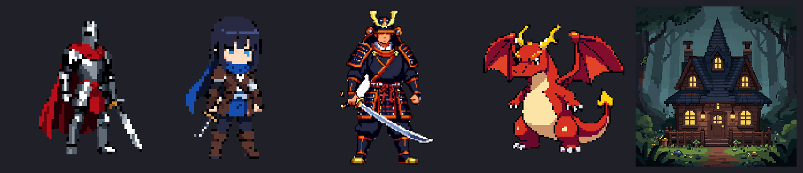
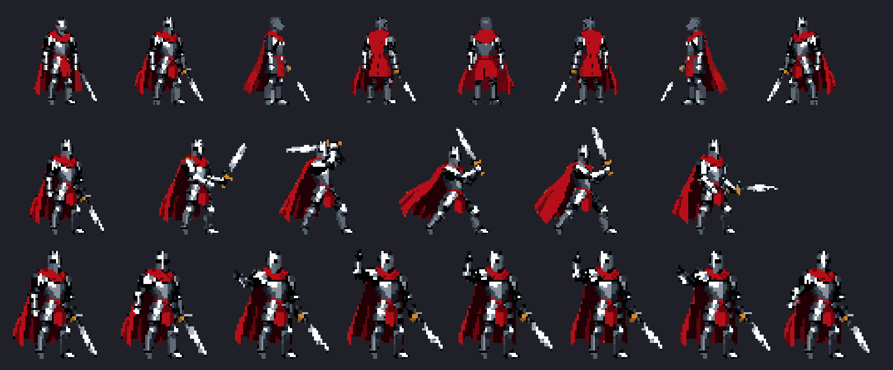
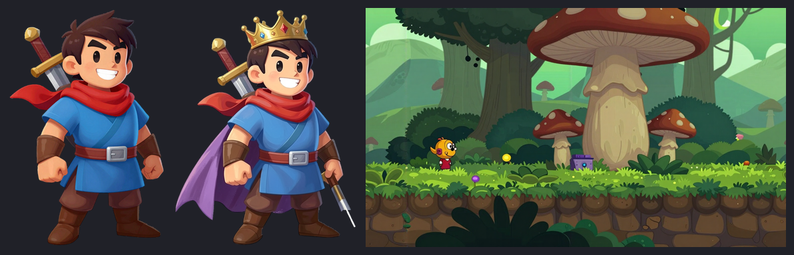
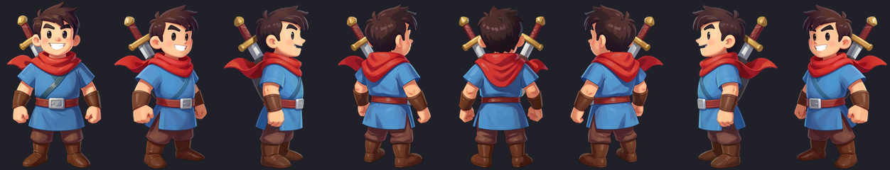
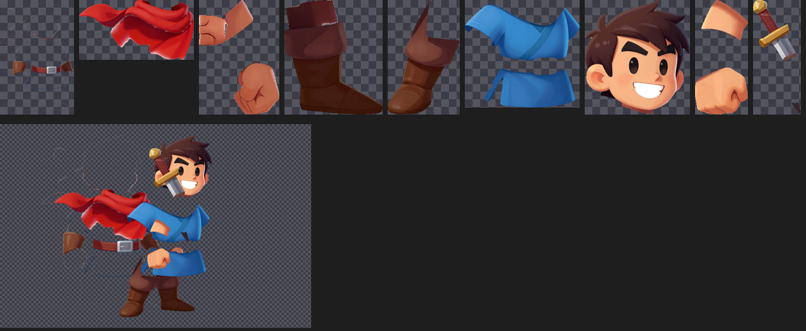
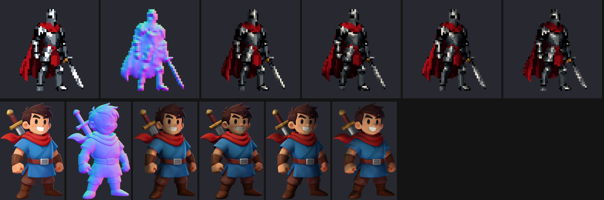

# SpriteKiln

**Free, local 2D game-art generation for ComfyUI**: pixel art and HD painted/cartoon art, sprites, rotations,
animations, spritesheets, tiles and tilesets, swappable equipment layers, cutout-rig parts and normal maps for
2D lighting. All of it runs on your own machine with open-weight models.

SpriteKiln is a ComfyUI node pack (`ComfyUI-SpriteKiln`, 41 nodes), a suite of 30 ready-made workflows, a model
downloader, a scripting CLI and an optional browser UI. Its feature set is modelled on hosted tools like Retro
Diffusion and PixelLab. It is not affiliated with either.








Developed and tested on an **Apple M5 Pro (48 GB unified memory), macOS, ComfyUI 0.41 on MPS**. Every workflow in
this README has run end to end on that machine; timings are in section 5. The models also run on NVIDIA GPUs,
but that setup is untested.

### Quick start
```bash
git clone https://github.com/brunocpf/spritekiln && cd spritekiln
./install.sh --models core anim     # node pack + workflows + examples + ~73 GB of models
# restart ComfyUI → sidebar: Workflows → SpriteKiln
python3 webui/serve.py              # optional browser UI on http://127.0.0.1:8189
```

---

## 1. What you get

| # | Workflow | Model(s) | Retro Diffusion / PixelLab equivalent |
|---|---|---|---|
| 01 | Text → Pixel Art | Z-Image Turbo + pixel LoRA | RD Fast (styles, size, palette, transparent bg) |
| 02 | Image → Pixel Art (direct + AI redraw) | Z-Image Turbo img2img | RD img2img / "strength" |
| 03 | Reference images → Pixel Art | FLUX.2 klein 4B + pixel LoRA | RD Plus reference images, PixelLab style reference |
| 04 | Edit pixel art (text + image refs) | FLUX.2 klein 4B | PixelLab "edit", RD Plus edit |
| 05 | Inpaint a region | FLUX.2 klein 4B | PixelLab inpainting |
| 06 | Rotate → 4/8 directions | FLUX.2 klein 4B | PixelLab rotations, RD turnaround |
| 07 | Rotate HQ | Qwen-Image-Edit-2511 + Multiple-Angles LoRA | PixelLab 8-dir (higher consistency) |
| 08 | Object → 4 views (2×2 sheet) | klein base + fal 2×2 LoRA | PixelLab isometric/top-down views |
| 09 / 09b | 4-dir walk spritesheet from text / reference | klein base + 4-walk LoRA | RD "walking" / spritesheet presets |
| 10 | Animate sprite (35 actions + custom free text) | Wan 2.2 I2V-14B + pixel-animate LoRA | RD Animation, PixelLab text animation |
| 11 | Animate, seamless loop / return-to-pose | Wan 2.2 14B first = last frame | RD Animation loops |
| 16 | **8-direction animated spritesheet** | klein rotations + Wan 2.2 14B | PixelLab 8-dir animations |
| 17 | Keyframe in-betweening / combos | Wan 2.2 14B first→last frame | PixelLab keyframe interpolation |
| 18 | **Equipment layer (paper doll)** | FLUX.2 klein 4B per frame + layer diff | swappable weapons/armour on shared animations |
| 12 | Seamless tile / texture | Z-Image + seamless patch | RD Tile "single tile / variations" |
| 13 | Autotile tileset (wang16 + blob47) | Z-Image + SpriteKiln | RD Tile "tileset" |
| 14 | Unfake / pixelize / palette swap (no AI) | — | RD palette tools, *unfake.js* |
| 15 | Sheet → GIF / APNG / Aseprite JSON (no AI) | — | export tools |
| 19 | **Text → animation / VFX** (no sprite needed) | Z-Image + Wan 2.2 14B | RD Animation from text, effect animations |
| 20 | **Animated seamless tile** (water, lava…) | Z-Image + Wan 2.2 14B + seamless patch | RD animated tiles |
| 21 | Colour ramps, palette swap, hue shift, Scale2x/3x (no AI) | — | RD colour / upscale tools |
| 22 | **HD 2D art from text** (painted / cartoon) | Z-Image Turbo, no pixel LoRA | non-pixel 2D game art |
| 23 | HD edit with text + image refs | FLUX.2 klein 4B | |
| 24 | HD rotate → 4/8 directions | FLUX.2 klein 4B | |
| 25 | HD animate (35 actions + free text) | Wan 2.2 14B, no pixel LoRA | |
| 26 | HD seamless texture + horizontally looping parallax layer | Z-Image + seamless patch | |
| 27 | **Character → rig parts** (cutout animation) | SAM3.1 + FLUX.2 klein completion | Spine / DragonBones / Godot Skeleton2D prep |
| 28 | **Sprite normal maps** (pixel or HD, sprites or whole sheets) | model-free | SpriteIlluminator / Laigter-style 2D lighting |
| 28b | HD normal maps with AI shape | MoGe-2 + sprite normals | HD-2D-style lit sprites |

Every AI output goes through the same **pixel-perfect pipeline**: background removal, snapping to a true pixel
grid at the exact art size, palette reduction or palette lock, cleanup and optional outline. You get real
1-pixel-per-pixel PNGs with transparency, not upscaled "fake" pixel art.

### HD painted / cartoon mode (workflows 22–27)
Non-pixel 2D art, e.g. Rayman-Legends-like painted cartoon, metroidvania hand-painted, cel-shaded anime, flat vector,
comic ink, storybook watercolour, chibi mobile, painted props, icons, VFX, parallax backgrounds and painted
textures (*SK HD Style Preset*). The HD workflows use the same models with the pixel LoRAs **off** and **no
grid/palette step**. `SK HD Cutout` produces full-resolution transparent PNGs with soft anti-aliased edges. It
uses the BiRefNet mask plus the backdrop key (gaps between limbs, ground shadows), cleans backdrop colour out of
edge pixels, and gives a whole animation one shared crop and size. APNG keeps full colour and soft alpha; the
GIF is a preview.

**Cutout rigs (27).** Rayman-style games animate characters as rigged *parts* rather than drawing every frame.
Workflow 27 prepares those parts:
1. You list the parts in back-to-front draw order (`cape, left arm, left leg, right leg, torso, head, right arm,
   sword`).
2. SAM3.1 finds each part from its name.
3. FLUX.2 klein redraws each part alone and *complete*, including areas hidden behind other parts. Visible pixels
   stay exactly as in the original.
4. The result is a folder of full-canvas aligned PNGs (import them as layers in Spine, DragonBones or a Godot
   Skeleton2D), cropped PNGs, `parts.json` (boxes, draw order, pivot guesses) and a composite preview.

Character pixels that no listed part claims (e.g. a belt or bracers) go into a `rest` layer at the back. To
separate them, add them to the list (`belt, left forearm…`). Start from a neutral A- or T-pose with limbs apart. (Qwen-Image-Layered was evaluated for this too. It returned the whole
character as one layer, not body parts, so it is not part of the suite.)

### Normal maps for 2D lighting (workflows 28 / 28b)
HD-2D games light their sprites with the engine's lights using a **normal map** per sprite. `SK Sprite Normal Map`
builds one from two sources: a rounded "pillow" from each sprite's silhouette (`inflate`, `radius`, automatic per
sprite) and relief from the art's shading (`detail`). It is pixel-exact at native resolution, so a 64×64 sprite
gets a 64×64 normal map. Feed it a whole spritesheet and every frame gets normals in the same layout. For HD art,
**28b** blends in **MoGe-2** AI normals (`ai_weight`), which read real 3D form (faces, folds, belts, armour) and
look much more convincing under a moving light. `SK Normal Map Light Preview` renders the sprite under a circling
light, so you can check the result before it goes into the engine.

| Engine | Where the normal map goes | Convention |
|---|---|---|
| Godot 4 | `CanvasTexture.normal_texture` on the Sprite2D / AnimatedSprite2D, plus `PointLight2D` / `DirectionalLight2D` | OpenGL |
| Unity (URP 2D) | Sprite Editor → *Secondary Textures* → `_NormalMap`, plus 2D lights with *Use Normal Map* | OpenGL |
| Unreal (Paper2D) | Normal texture in a lit sprite material | DirectX |

### Resolution and art styles (8-bit → 32-bit → HD-2D)
Art size is free: every preset has a default, and you can set any `art_width/height` (16 px icons up to 256 px+
bosses and backgrounds). The presets cover the eras and looks:
**8-bit (NES)**, **16-bit (SNES/Mega Drive)**, **GBA (32-bit handheld)**, **32-bit (PS1/Saturn/arcade)**,
**HD-2D character (Octopath-like)**, **HD-2D portrait**, **high-detail modern (indie)**, **arcade fighter (large
sprite)**, **boss (large)**, plus characters, monsters, items, UI, VFX, textures, isometric, top-down, 1-bit, and more
(37 in total). Each preset also sets the **pixel-LoRA strength**. Strong (1.0) forces chunky, low-res pixels. Weak
(0.35–0.5) lets the model draw fine detail, which the large / high-detail styles use (32-bit, high-detail modern,
arcade fighter, boss). The HD-2D presets use 0.6–0.8 and GBA uses 0.7. HD-2D here means the *sprites*. The 3D
dioramas, tilt-shift and lighting of HD-2D games belong to your engine.

### Animation actions (workflows 10 / 11 / 16 / 19)
idle · walk · run · **sword slash** · **attack combo (3 hits)** · thrust/stab · ranged attack · kick · cast spell ·
charge up · **crouch** · crouch idle · block/guard · dodge roll · dash · slide · jump · climb · hurt · death ·
victory/emote, and for non-humanoids: creature idle · slime bounce · wing flap/fly · slither/crawl · monster
bite/claw · roar · fire/torch flicker · sway (trees, grass, banners) · water flow · chest/door opening · coin/item
spin · hover · glow pulse · explode/break · plus custom (free text).

**Non-humanoids.** Nothing is skeleton-based, so monsters, creatures, vehicles, props, effects and environment pieces
work in every workflow (generate, edit, rotate, animate, layer). The one exception is the 4-direction walk-sheet LoRA
(09), which is trained on humanoids. Use the `view` option *keep facing direction* for objects.
Looping actions (idle, walk, run, …) get an automatic **loop finder**. One-shot actions (slash, combo, death, …)
are sampled start-to-end. For longer combos, chain moves with **17 Keyframe in-betweening**. Each move's end pose
becomes the next move's start pose, so the frames line up exactly.

### Text → animation (any motion you can describe)
Set **action = custom** in *SK Animation Preset* and write the motion in `custom_motion`, e.g.
*"moves his right arm up and points to the sky, then returns his arm to the previous position"*.
* **11 (HQ)** pins the first *and* last video frame to your sprite, so "…then returns to the previous position"
  is guaranteed and the clip loops.
* **10** and **16 (all 8 directions)** start from the sprite and run freely.
* **19** needs no sprite at all: text → first frame → animation (characters, creatures, effects).
* **17** goes from one pose to another pose you supply.

The result is the same as for presets: a spritesheet, frames, GIF/APNG and Aseprite JSON. From the command line:
```bash
python3 scripts/sk_run.py 11_animate_sprite_hq_loop --image sprite=hero.png \
  --set "SK_AnimationPreset.action=custom" \
  --set "SK_AnimationPreset.custom_motion=raises his arm and points to the sky, then lowers it again"
```

### Modular equipment / paper-doll layering (workflow 18)
1. Make a **base** character: ideally a plain version without the gear (underwear/undersuit), so gear only *adds* pixels.
2. Animate the base with 10, 11, 16 or 17. You get a sheet with a fixed frame grid.
3. Run **18 Equipment layer** once per item (sword, axe, helmet, plate armour…). Each base frame is re-dressed by
   FLUX.2 klein from a reference picture of the item, using the same seed for every frame. The frame is snapped
   back to the base's exact grid, and only the pixels that differ from the base are kept, as a transparent layer.
4. By default 18 dresses the **first 4 frames** (the *Frames to dress* node) into a one-row sheet, for speed. For a
   full set, set *Frames to dress* to all frames and `sheet_columns` on the save node to the base sheet's column
   count. The layer sheet then has **the same layout as the base sheet**. In the engine, draw `base → armour → weapon`
   for the same frame index. `SK Composite Layers` previews any combination inside ComfyUI.

Limitations: anything the gear hides *behind* the body (a cape behind the legs, a sheathed sword on the back) is
part of the layer only where it is visible. Use separate front/back layers if your engine needs that, by running
18 twice with prompts like "only the cape". AI re-dressing can wobble between frames. Fix single frames by hand
or rerun with another seed, and raise `tolerance` if body pixels leak into the layer.

---

## 2. Install

```bash
cd spritekiln
./install.sh --models core anim   # nodes + workflows + examples + images (~37 GB) + animation (~36 GB)
./install.sh --models hq-rotate   # optional: Qwen multi-angle rotations (~31 GB)
./install.sh --models parts       # optional: rig parts + AI normal maps (~2.4 GB)
```
Then restart ComfyUI and open **Workflows → SpriteKiln** in the sidebar.

`install.sh` finds ComfyUI in the Comfy Desktop location (`~/ComfyUI-Installs/ComfyUI/ComfyUI`), `~/ComfyUI` or
`~/Documents/ComfyUI`. Set `COMFYUI_DIR` for anything else. Models go to `~/ComfyUI-Shared/models` (Comfy Desktop)
or `$COMFYUI_DIR/models`; override with `MODELS_DIR`. Example images go to `~/ComfyUI-Shared/input`, or
to `$COMFYUI_DIR/input` if that folder does not exist. `--models` with no tier downloads `core anim`. You can also
run `scripts/download_models.sh [core|anim|hq-rotate|all]` on its own. It resumes interrupted downloads and skips
finished files. Only the GUI workflows are copied into ComfyUI; the API versions used by `sk_run.py` stay in
`workflows/api/`.

`install.sh` copies `ComfyUI-SpriteKiln/` into `custom_nodes/`, installs **ComfyUI-GGUF** (Wan 14B / Qwen GGUFs), copies the
workflows into your ComfyUI workflow library and the example images into the input folder. Models go to
`~/ComfyUI-Shared/models` (the Comfy Desktop shared folder). Override paths with `COMFYUI_DIR`, `MODELS_DIR`
and `INPUT_DIR`. Downloads use `aria2c` (8 connections per file) when it is installed (`brew install aria2`)
and are resumable.

Requirements: a recent ComfyUI (0.41+, which has the FLUX.2 klein, Wan 2.2, SAM3, MoGe and background-removal
nodes built in), Python packages that ComfyUI already ships (numpy, scipy, Pillow, torch), and `git`. `aria2c` is
optional and speeds up downloads. Memory: 48 GB unified memory or ~24 GB VRAM is comfortable for every workflow.
The image-only workflows also fit in less.

### Model stack (all open weights)
| Tier | Files | Size | License |
|---|---|---|---|
| core | Z-Image Turbo bf16, Qwen3-4B TE, Flux VAE | 20 GB | Apache-2.0 |
| core | FLUX.2 klein 4B distilled + base (bf16), flux2 VAE | 15.8 GB | Apache-2.0 |
| core | BiRefNet (background removal) | 0.4 GB | MIT |
| core | LoRAs: tarn59 Z-Image pixel art, Limbicnation klein pixel art, svntax 4-walk sheet, fal 2×2 sheet | 0.7 GB | Apache-2.0 |
| anim | Wan 2.2 I2V-14B GGUF Q4_K_M (high + low), UMT5-XXL fp16, Wan 2.1 VAE, styly-agents pixel-animate LoRA, Lightning 4-step LoRAs | 36 GB | Apache-2.0 |
| hq-rotate | Qwen-Image-Edit-2511 GGUF Q4_K_M, Qwen2.5-VL-7B TE (bf16), Qwen-Image VAE, fal Multiple-Angles LoRA, Lightning LoRA | 31 GB | Apache-2.0 |
| parts | SAM3.1 (rig parts), MoGe-2 normals (HD normal maps) | 2.4 GB | Meta SAM license / MIT (MoGe) |

**Why these choices on Apple Silicon.** MPS cannot hold fp8 tensors, so ComfyUI would up-cast fp8 checkpoints to
16-bit anyway. The suite therefore uses bf16/fp16 files for the small models and GGUF Q4 for the 14B/20B ones,
which ComfyUI-GGUF de-quantises on the fly. FLUX.2 **klein 4B** was picked over 9B because it is Apache-2.0 and
has the pixel-art LoRA ecosystem. Z-Image Turbo gives the fastest text-to-image (8 steps). **Wan 2.2 TI2V-5B was
tested and rejected.** On MPS it produced colour-corrupted video even at its native 1280×704, and it was slower
(702 s) than Wan 14B Q4 with the 4-step Lightning LoRAs (~450 s), which also has a pixel-art animation LoRA.
If you downloaded it earlier, `wan2.2_ti2v_5B_fp16.safetensors` and `wan2.2_vae.safetensors` (11.4 GB) can be deleted.

---

## 3. Using the workflows

* **Sizes are art pixels.** `art_width/height` is the final sprite size (e.g. 64×64). The model renders at about
  1024 px and SpriteKiln snaps the result to that exact grid.
* **Styles.** `SK Pixel Style Preset` has 37 presets (see *Resolution and art styles*). A preset sets the prompt
  wording, art size, colour count, background and pixel-LoRA strength. Any non-zero override wins.
* **Palettes.** `SK Palette` supports `auto` (k-means in OKLab), 15 built-in presets (PICO-8, Game Boy, C64, CGA,
  Endesga 16/32, Sweetie 16, SLSO8, Nyx8, …), `hex` strings and `palette_image`, which locks the output to the
  colours (up to `colors`) of any image (e.g. your original sprite). Dithering: Bayer 2/4/8 (use this for animations: the pattern
  is fixed, so it does not shimmer) and Floyd–Steinberg (stills; transparent pixels are skipped). Drop Lospec
  `.hex`, Paint.NET `.txt` (AARRGGBB) or GIMP `.gpl` files into `custom_nodes/ComfyUI-SpriteKiln/palettes/`. A
  palette with no readable colours raises an error instead of silently falling back.
* **Cleanup** merges only small clusters (`speck_size`, default ≤ 2 px) whose colour is close to their surroundings
  (`max_contrast`). 1-px eyes, highlights and dither patterns survive. Set `speck_size` to 0 to disable it.
* **Editing round-trips.** 04/05/06/07/10/11/16/17 take a sprite at native size. `SK Sprite → Model Canvas`
  upscales it by an integer factor for the model, and `SK Pixel Perfect (match_reference)` snaps the result back
  to the *same* grid. Edits never drift by half a pixel.
* **Outputs** land in `output/spritekiln/`: `name.png` (native), `name_x8.png` (preview) and, for animations,
  `_fNN.png` frames, `_sheet.png` + `_sheet.json` (Aseprite/Phaser/Godot-compatible frame data with one tag per
  row), GIF and APNG (native and upscaled), plus one upscaled GIF per row for multi-direction sheets. Files are named
  `<prefix>_00001…`, and APNGs end in `.apng.png`.

### Web UI
`python3 webui/serve.py` starts a Retro-Diffusion-style browser front end at http://127.0.0.1:8189. It has forms for
all workflows, image uploads, progress and cancel, and a pixel-zoom gallery with GIF/sheet/JSON downloads.
See `webui/README.md`.

### Scripting (local "RD API")
```bash
python3 scripts/sk_run.py 01_text_to_pixel_art --set "SK_StylePreset.subject=a goblin archer" --seed 7
python3 scripts/sk_run.py 10_animate_sprite --image "sprite=hero.png" --set "SK_AnimationPreset.action=sword slash"
python3 scripts/sk_run.py 16_8dir_animated_spritesheet --image sprite=hero.png --set "SK_AnimationPreset.action=walk"
python3 scripts/sk_run.py 06_rotate_8_directions --list      # show editable nodes/inputs
```
`sk_run.py` also takes `--out DIR` (where result files are copied, default `./spritekiln_out`), `--server` and
`--timeout`. API-format graphs are in `workflows/api/`. The node pack in ComfyUI is a *copy*: after you edit
`ComfyUI-SpriteKiln/`, run `./install.sh` again and restart ComfyUI. Regenerate everything from code with `python3 build/build_workflows.py`
(it reads the live `/object_info`, so widget orders always match your ComfyUI version).

---

## 4. SpriteKiln nodes

| Node | Purpose |
|---|---|
| SK Pixel Style Preset | RD-style presets → prompt, art size, model size, colours, transparency |
| SK Pixel Perfect | fake → real pixel grid: `fixed_size`, `auto_detect` (fractional grid detection), `scale_factor`, `match_reference`; dominant/median/mean/nearest sampling |
| SK Palette | k-means / preset / hex / palette-image, shared across frames, Bayer & Floyd–Steinberg dithering |
| SK Pixel Cleanup + Outline | contrast-aware speck removal (clusters ≤ N px), hard alpha, outer/inner outlines |
| SK Background → Transparent | `mask_and_key` (BiRefNet mask + backdrop key: enclosed gaps, edge defringe, ground-shadow removal), `key_refine` (same, no mask), border flood-fill, global key |
| SK Sprite → Model Canvas / SK Expand Canvas / SK Region Mask / SK Masked Merge | edit & inpaint helpers |
| SK Direction Prompts / SK Assemble Directions | 4/8-direction prompt lists (klein or Qwen multi-angle syntax), west mirroring, animated rows |
| SK Animation Preset | 35 actions + custom (combat, movement, creatures, props/FX) → motion prompt, frame count, fps, loop flag |
| SK Select Animation Frames | loop finder, even sampling, ping-pong |
| SK Stabilize Sprite Frames | removes video drift, anchored on the feet (extended arms/weapons don't drag the body) |
| SK Crop Frames to Content | uniform tight frame size for a whole animation |
| SK Pixel Upscale | Scale2x / Scale3x / Scale4x (EPX family) and nearest |
| SK Colour Ramp / SK Palette Swap / SK Hue Shift | hue-shifted ramps, exact colour swaps, OKLab recolours |
| SK Seamless Tiling + SK Seamless VAE Decode | tileable output from any model incl. DiTs (latent rolling) |
| SK Autotile Tileset | wang16 (2-corner / dual-grid) and blob47 sets + bitmask mapping |
| SK Frames → Spritesheet / Spritesheet → Frames / Image List → Batch / Tile Preview / Scale Nearest | utilities |
| SK Extract Equipment Layer / SK Composite Layers / SK Batch → Image List | paper-doll gear layers aligned to a base animation |
| SK HD Style Preset / SK HD Cutout / SK HD Art → Model Canvas | HD painted/cartoon presets, soft-edged decontaminated cutouts with shared crop + Lanczos resize, HD canvases for edit/video models |
| SK Rig Part Prompts / SK Rig Part Cutout / SK Save Rig Parts | named parts → SAM3 prompts + completion prompts, aligned part layers, PNG + JSON export |
| SK Sprite Normal Map / SK Normal Map Light Preview / SK Flatten | 2D-lighting normal + height maps (OpenGL/DirectX, optional MoGe blend), moving-light preview, RGBA → RGB |
| SK Save Pixel Art | PNG (+upscaled), sheet, Aseprite JSON (tags named per row, e.g. S/SE/E…), GIF (+ one per row), APNG |

---

## 5. Measured performance (Apple M5 Pro / 48 GB)
Wall-clock times from the test runs (models already on disk; the first run of a model family adds 20–60 s to load it).

| Workflow | Output | Time |
|---|---|---|
| 01 Text → pixel art (Z-Image, 8 steps @1024) | 64×64 sprite | ~15 s (76 s cold) |
| 02 Image → pixel art (direct + redraw) | 2 × 96×96 | 30 s |
| 03 Reference → pixel art (klein, 2 refs) | 64×64 | 74 s |
| 04 Edit (klein, 2 refs) | 64×64 ×2 palettes | 50 s |
| 05 Inpaint | 64×64 | 38 s |
| 06 Rotate 8 directions (5 generated + 3 mirrored) | 8-frame sheet | 138 s |
| 08 Object 2×2 views (klein base, 20 steps CFG 5) | 4 views | 220–275 s |
| 09 / 09b Walk spritesheet (klein base, 24 steps @512) | 128×128 sheet + 4 GIFs | 52 s / 74 s |
| 10 / 11 Animate (Wan 2.2 14B Q4, 4 steps, 33 frames @640²) | 4–12-frame sheet + GIF | 500–640 s |
| 12 Seamless tile | 32×32 tile | 10–48 s |
| 13 Autotile tilesets (2 textures + wang16 + blob47) | 2 sheets | 14 s |
| 14 / 15 / 21 no-AI tools | | ~2 s |
| 16 8-direction animated sheet | 8 rows × N frames | ~40 min (5 rotations + 5 animations, 33 frames) |
| 16 with `directions = 4`, 17 video frames | 4 rows × 8 frames | 761 s |
| 17 Keyframe in-between (17 frames) | 6-frame sheet | 265 s |
| 19 Text → animation / VFX | 8-frame sheet | 576 s |
| 20 Animated seamless tile | 8-frame tile + 3×3 check | 496 s |
| 07 Rotate HQ (Qwen 2511 GGUF, 5 views) | 8-frame sheet | 525 s |
| 18 Equipment layer (4 frames) | layer sheet + preview | 178 s |
| 22 HD text → art | 768 px transparent PNG | 50 s |
| 23 HD edit (2 refs) | 768 px | 93 s |
| 24 HD rotate 8 directions | 8-view sheet | 217 s |
| 25 HD animate (33 frames) | 6–12-frame HD sheet + APNG | 534 s |
| 26 HD texture + parallax layer | 512 px tile + 1344×768 layer | 74 s |
| 27 Character → rig parts (8 parts) | aligned layers + JSON | ~5 min |
| 28 Sprite normal map (64×64 knight) | normal + height + lit preview | 10 s |
| 28b HD normal map with MoGe (504×768 hero) | normal + height + lit preview | 22 s |

Memory: every workflow ran within the 48 GB of unified memory. ComfyUI unloads models between stages.

---

## 6. Tips
* Sprites with a plain background key out most reliably. The style presets add one automatically. If a white
  object on a white background loses parts (e.g. a silver blade), set `background` to `gray` or `green`.
* Video models want room to move: keep `padding` at 8+ art pixels for attacks and jumps.
* For the most consistent rotations, generate the front view first, then run 07 (HQ). Use 06 for speed.
* If the Qwen multi-angle LoRA's left/right comes out swapped for your subject, switch `prompt_style` on *Direction
  Prompts* to klein (workflow 06's prompts), or swap the E/W outputs. The *Assemble Directions* order only
  re-sequences frames that are already labelled.
* Grid auto-detect measures the first frame and applies that grid to the whole batch, so frames stay aligned.
* Wan clips: `Video frames` must be 4n+1 (17, 33, 49…). More frames means smoother motion and longer runtime.
* Animation sharpness depends on how many video pixels each art pixel gets. The 14B workflows use a 640×640
  canvas (8 video px per art px for a 64-px sprite + padding). For bigger sprites raise `target_width/height`
  on *Sprite → Model Canvas* (e.g. 960×960). That is cleaner but slower.
* klein base (08/09) uses CFG 5 with 20–24 steps. The distilled model is 4 steps and is used everywhere else.

## 7. Tests
`tests/test_core.py` covers the pixel algorithms: OKLab round trip, grid detection (fractional), downscale recovery, palette
quantisation, alpha-aware Floyd–Steinberg, speck cleanup (keeps highlights and dither), palette parsing (Lospec /
Paint.NET), Scale2x/3x, colour ramps, background keying with grid lines, and `refine_background` (enclosed gaps,
halo, ground shadow, and keeping teeth/eye whites that the segmentation mask marks as foreground), and sprite normal maps
(outward-facing rims, OpenGL vs DirectX green channel, encode/decode). Run it with
`~/ComfyUI-Installs/ComfyUI/ComfyUI/.venv/bin/python tests/test_core.py`. `tests/test_builder.py` checks the
workflow generator: inputs named `mode` reach their node, bypass handling, widget order and link types. It runs
with plain `python3`.

## 8. Sources & credits
Retro Diffusion (https://github.com/Retro-Diffusion/api-examples), PixelLab (https://www.pixellab.ai/docs),
Astropulse pixeldetector / ComfyUI-PixelArt-Detector, unfake.js / ComfyUI-PixelArt-Unfaker (ideas behind
`auto_detect`), Z-Image (Tongyi-MAI), FLUX.2 klein (Black Forest Labs), Wan 2.2 (Alibaba), Qwen-Image-Edit-2511,
LoRAs by tarn59, Limbicnation, svntax-dev, fal, styly-agents and lightx2v, BiRefNet, city96/ComfyUI-GGUF.

## 9. License
SpriteKiln's code (node pack, workflows, scripts, web UI) is licensed under the **GNU GPL v3.0**, the same license as
ComfyUI. See [LICENSE](LICENSE). The **models are not part of this repository**. The downloader fetches them from
their authors, and each has its own license (table in section 2). Check those before using outputs commercially.
The example images in `examples/` and `docs/` were generated with SpriteKiln.
